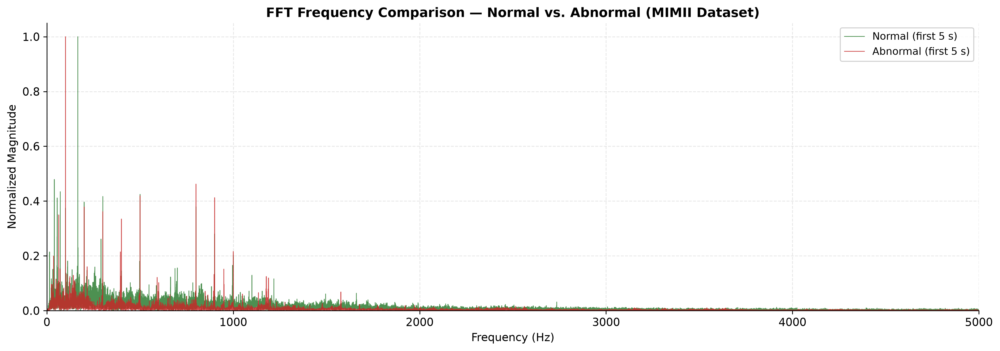
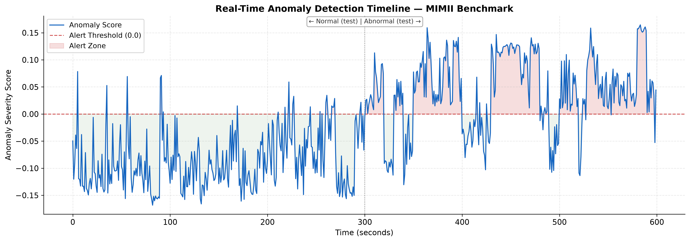

# ToneGauge: Offline Acoustic Early-Warning for MSMEs
*Tech4Bharat 4.3 (Agentic AI)*




## Problem
Small workshops run machines until they fail. Existing predictive-maintenance tools need cloud connectivity, dedicated sensors and labelled failure data, which small shops don't have.

## Solution
ToneGauge listens to a machine with a phone microphone, learns what normal sounds like, and flags drift. It drafts a maintenance plan for the owner, who approves every action.
**Status:** the prototype runs as a Python pipeline. It is designed for on-device use. Android packaging and baseline refinement over days are planned, not built.

## Pipeline (built)
- 1-second non-overlapping windows, [16 kHz mono]
- Features per window: [list exactly what the code computes, e.g. RMS, spectral centroid, bandwidth, zero-crossing rate, high-frequency energy ratio]
- Isolation Forest (`n_estimators=[ ]`, `contamination=[ ]`), trained only on normal clips
- Clip decision rule: a clip is flagged abnormal if [rule, e.g. more than X% of its windows exceed the threshold]. Threshold set from training data only.

## Evaluation (MIMII, 6 dB pump, id_00)
6 dB SNR means real factory noise is mixed in. Split is **by clip**, so no clip appears in both train and test (seed = [ ]).

| Set | Clips | Result |
|---|---|---|
| Train (normal) | 60 | n/a |
| Test, normal | 30 | [y]/30 falsely flagged |
| Test, abnormal | 30 | [x]/30 detected |

Preliminary. One machine ID, one pump type.

## Scheduling agent (built)
Given a detected anomaly and the shift end time entered by the owner, it proposes a 60-minute maintenance window starting 30 minutes after shift end, and drafts a message to the mechanic. **The message is not sent; owner approval is required.**

## UI (designed prototype)
Illustrative wireframes with placeholder values. Not connected to the pipeline.

## Limitations & next steps
- Tested on one pump ID only. No other machine types yet.
- Phone microphone differences, background noise and load states need separate profiles.
- Next: test more MIMII IDs and machine types, then field validation at local mills in Coimbatore.

## How to run
Place MIMII clips under `6_dB_pump/pump/id_00/normal` and `.../abnormal` (not included; download from the dataset link).
```bash
python3 -m pip install numpy librosa scipy scikit-learn matplotlib soundfile
python3 pipeline.py
```

## Dataset
MIMII Dataset, Zenodo record 3384388. Purohit et al., "MIMII Dataset", DCASE 2019. [Check and state the licence.]
